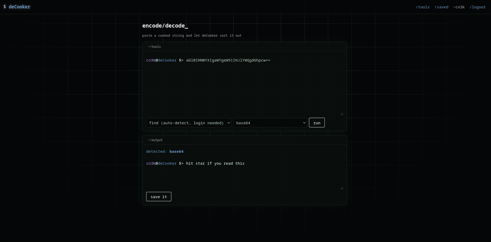

# deCooker

deCooker is a small encoder/decoder web app built with native php. encode and decode base64, hex, URL, binary, HTML entities and ROT13, or generate hashes.

## Preview


## Installation

you need **PHP 8 or newer** with the `pdo_sqlite` extension, and **git**. there is no database to set up, the SQLite file is created automatically on first run.

### macOS
```bash
brew install php git
```

### Debian / Ubuntu
```bash
sudo apt update
sudo apt install php-cli php-sqlite3 git
```

### Arch Linux
```bash
sudo pacman -S php php-sqlite git
sudo sed -i 's/^;extension=pdo_sqlite/extension=pdo_sqlite/; s/^;extension=sqlite3/extension=sqlite3/' /etc/php/php.ini
```

## Usage

check that SQLite support (for `pdo_sqlite` and `sqlite3`):

```bash
php -m | grep -i sqlite
```

then clone the project and start the built-in server:

```bash
git clone https://github.com/cn3k/decooker.git
cd decooker
php -S localhost:8000 -t public
```

Open http://localhost:8000 in your browser.
